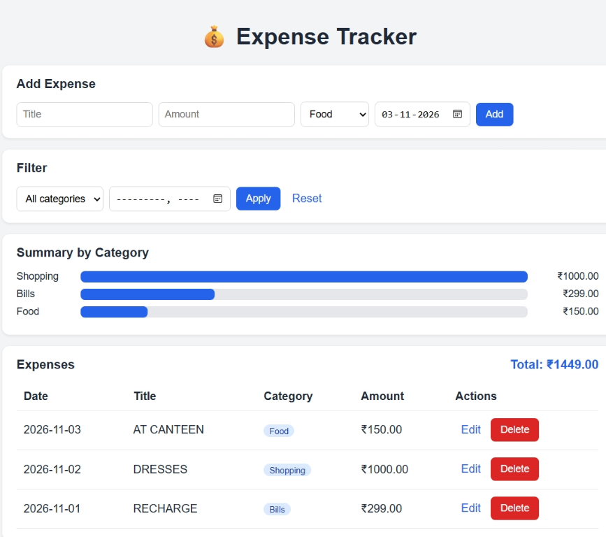

# Expense Tracker



A Flask web app to record, categorize and summarize daily expenses.

## Features
- Add, edit and delete expenses (CRUD)
- Filter by category and month
- Category-wise summary with bars and total amount
- SQLite database with SQL queries

## Tech Stack
Python, Flask, SQLite, HTML, CSS

## Run Locally
```
python -m venv venv
venv\Scripts\activate
pip install -r requirements.txt
python app.py
```
Open http://127.0.0.1:5000
